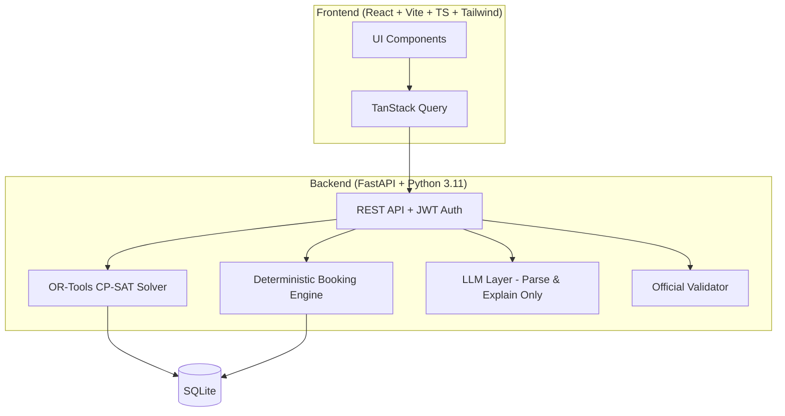

# CIT Campus Scheduling and Venue Management Platform

> A web platform for Chilika Institute of Technology (CIT) that generates clash-free weekly timetables and midsem exam schedules using a constraint solver, decides venue bookings deterministically by priority rules, reschedules with the fewest possible moves after disruptions (with admin approval), and uses an LLM only to read text and explain — never to decide validity.

## Architecture



## Tech Stack

| Layer | Technology |
|-------|-----------|
| Backend | Python 3.11, FastAPI, Pydantic v2, SQLAlchemy, OR-Tools CP-SAT |
| Frontend | React 18, Vite, TypeScript, Tailwind CSS, TanStack Query |
| Auth | JWT with 4 seeded demo roles |
| Database | SQLite (Postgres-compatible schema) |
| LLM | Provider abstraction with NullLLM fallback |
| Deploy | Backend: Render/Railway, Frontend: Vercel/Netlify |

## Demo Accounts

| Role | Username | Password |
|------|----------|----------|
| Admin | `admin` | `admin123` |
| Department Coordinator | `coordinator` | `coord123` |
| Faculty | `faculty` | `faculty123` |
| Club Representative | `clubrep` | `clubrep123` |

## Setup

### Prerequisites
- Python 3.11+
- Node.js 18+
- npm or yarn

### Backend
```bash
cd backend
python -m venv venv
source venv/bin/activate  # Windows: venv\Scripts\activate
pip install -r requirements.txt
cp ../.env.example .env  # Edit with your settings
python -m app.db.seed     # Seed demo data
uvicorn app.main:app --reload --port 8000
```

### Frontend
```bash
cd frontend
npm install
npm run dev
```

### Run Tests
```bash
cd backend
pytest
```

### Generate & Export Schedule
```bash
cd backend
python -m app.solver.timetable    # Generate timetable
python -m app.solver.exams        # Generate exam schedule
python -m app.export              # Export schedule.json
```

## Deployed URL

> TODO: Add deployed URL after first deployment

## Known Limitations

> TODO: Document after implementation

## Project Structure

```
/backend          - FastAPI backend
  app/
    api/          - Route handlers (auth, timetable, exams, bookings, etc.)
    core/         - Config, security, roles, logging
    domain/       - Pure dataclasses: Session, Room, Faculty, Group, etc.
    data/         - Loader for cit_public.json
    solver/       - CP-SAT models: timetable, exams, reschedule
    validation/   - Own validator + official validator wrapper
    booking/      - Priority engine, alternatives, reasons
    ai/           - LLM client, parsers, guardrails, explainer
    services/     - Orchestration, approvals, audit log
    db/           - SQLAlchemy models, migrations, seed
  tests/
/frontend         - React + Vite + TypeScript frontend
/data             - Starter pack (read-only)
/exports          - Generated schedule.json files
/docs             - Architecture, decisions, demo script
```

