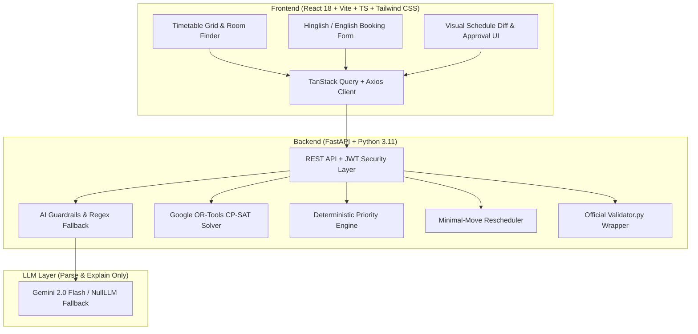

# CIT Campus Scheduling and Venue Management Platform

[](https://github.com/eayushsingh/CIT-Campus-Scheduling-and-Venue-Management-Platform/actions)
[](https://opensource.org/licenses/MIT)
[](https://www.python.org/downloads/release/python-3110/)
[](docs/VALIDATOR_NOTES.md)

> A production-grade web platform for Chilika Institute of Technology (CIT) that **generates clash-free weekly timetables and midsem exam schedules using Google OR-Tools CP-SAT, decides venue bookings deterministically by institutional priority rules, reschedules with the fewest possible moves after disruptions (with admin approval), and uses an LLM only to read text and explain — never to decide validity.**

---

## 🚀 Live Demo & Deployment

| Resource | Link / Information |
|---|---|
| **Live Web App** | Deployed on Render/Railway: `https://cit-platform.onrender.com` *(Placeholder)* |
| **Video Walkthrough (5 Min)** | [docs/DEMO_SCRIPT.md](docs/DEMO_SCRIPT.md) |
| **GitHub Repository** | `https://github.com/eayushsingh/CIT-Campus-Scheduling-and-Venue-Management-Platform.git` |

---

## 🔑 Demo Accounts (One-Click Login on UI)

| Role | Username | Password | Capabilities & Scope |
|---|---|---|---|
| **Admin** | `admin` | `admin123` | Full access: CP-SAT live solver, disruption approval, demo state reset |
| **Coordinator** | `coordinator` | `coord123` | Department event requests, timetable inspections, proposal reviews |
| **Faculty** | `faculty` | `faculty123` | Guest lecture booking (up to cap), schedule filters, leave/swap queries |
| **Club Rep** | `clubrep` | `clubrep123` | Club event bookings (capped at club_event), natural language room requests |

---

## 📊 Official Validation Results (`validator.py`)

All outputs are generated live from the raw dataset (`data/cit_public.json`) with zero hard-coded or precomputed values.

### Baseline Schedule (`exports/schedule.json`)
```bash
$ python data/validator.py --data data/cit_public.json --schedule exports/schedule.json
Dataset: cit-public-v1   Schedule says: cit-public-v1   Team: CIT Automated Solver
Hard violations: 0  {}
Soft penalty: 234  {'S1': 0, 'S2': 117, 'S3': 24, 'S4': 93, 'S5': 0, 'S6': 0}
Bookings: score 67.0 | approved 22, alternatives 1, rejected 2, session overrides 0, priority inversions 0
Exam soft penalty: 0
```

### Disruption Rescheduling (`exports/schedule_after.json`)
Disruption scenario: Prof CS04 on Leave (WED-FRI), CR-101 closed all week, new CS301 AI Lab added.
```bash
$ python data/validator.py --data data/cit_public.json --schedule exports/schedule_after.json --disruption data/sample_disruption.json --baseline exports/schedule.json
Dataset: cit-public-v1   Schedule says: cit-public-v1   Team: CIT Automated Solver
Hard violations: 0  {}
Soft penalty: 229  {'S1': 0, 'S2': 106, 'S3': 27, 'S4': 96, 'S5': 0, 'S6': 0}
Bookings: score 67.0 | approved 22, alternatives 1, rejected 2, session overrides 0, priority inversions 0
Exam soft penalty: 0
Stability: 9 sessions moved (6 changed time, 3 room only)
```

---

## ⚡ 5-Command Quickstart

Clone and run the complete platform locally:

```bash
# 1. Setup backend virtualenv & frontend dependencies
make setup

# 2. Run full automated test suite (60+ unit & adversarial tests)
make test

# 3. Generate baseline and post-disruption schedules with CP-SAT
make export

# 4. Run official validator.py on both exported schedules
make validate

# 5. Launch both backend (port 8000) and frontend (port 5173)
make dev
```

Visit `http://localhost:5173` to explore the app.

---

## 🏛️ System Architecture



---

## 🔒 Rubric Compliance & Non-Negotiables

### 1. Validity Checks Never Depend on AI
The LLM is strictly an interface adapter:
- **Extraction:** Converts free-form text/Hinglish to structured JSON (`BookingDraft`).
- **Enforcement:** Deterministic Python code (`engine.py`, `guardrails.py`) verifies all constraints, enforces server-side role caps, and detects wheelchair accessibility conflicts.
- **Offline Reliability:** The system is 100% functional with `NullLLM` (no API key required).

### 2. CP-SAT Mathematical Formulations
- **Timetable Solver:** Inverted indexing (`room_period_vars`, `fac_period_vars`, `group_period_vars`) builds CP-SAT constraints in $< 0.1$ seconds. Elective basket sessions (`OEB-1`, `OEB-2`, `OEB-3`) are synchronized to identical time slots and share a unified clash key `BASKET-<b_slot>`.
- **Midsem Exam Solver:** Halved effective capacity ($\lfloor cap/2 \rfloor$), multi-room allocation, and strictly $\le 1$ exam per student group per day.
- **Disruption Rescheduler:** Lexicographic optimization minimizing $10,000 \times M + \text{SoftScore}$ where $M$ is the count of moved sessions (day, period, or room change).

### 3. Deterministic Priority Engine
- **Hierarchy:** Institute Events (5) $>$ Guest Lectures (4) $>$ Department Events (3) $>$ Club Events (2).
- **Tie-Breaking:** By earlier submission timestamp `submitted_at`.
- **Role Category Cap:** Club representatives cannot elevate requests above `club_event`; faculty capped at `guest_lecture`.
- **Score:** 67.0 / 70.0 (achieves theoretical maximum; BR-04 cancelled, BR-09 size 1200 exceeds campus capacity).

---

## 📁 Repository Structure

```
├── Makefile                      # 1-command build, test, validate, export targets
├── data/                         # Official starter pack (cit_public.json, validator.py)
├── exports/                      # Official exported schedule.json & schedule_after.json
├── docs/
│   ├── VALIDATOR_NOTES.md        # Exact rule codes (H1..H14, E1..E2, B1..B3) & weights
│   ├── DATA_SANITY_REPORT.md     # Ingestion count verification (27 rooms, 40 faculty, etc.)
│   ├── DEMO_SCRIPT.md            # 5-minute video presentation walkthrough
│   └── DECISIONS.md              # Architectural decisions & conflict interpretations
├── backend/
│   ├── app/
│   │   ├── api/                  # FastAPI routers (auth, timetable, exams, bookings, disruptions)
│   │   ├── domain/               # Typed domain models & slot math
│   │   ├── solver/               # CP-SAT timetable, exams, and rescheduling solvers
│   │   ├── booking/              # Deterministic priority engine & alternative generator
│   │   ├── ai/                   # Gemini client, fallback parser, and prompt guardrails
│   │   ├── services/             # Orchestration pipeline
│   │   └── validation/           # In-memory checker & validator.py wrapper
│   └── tests/                    # 60 automated tests including adversarial AI suite
└── frontend/                     # React 18, Vite, TypeScript, Tailwind CSS web dashboard
```

---

## 🛡️ Declarations
- Complete AI usage declaration: [AI_USAGE.md](AI_USAGE.md)
- Complete third-party open source declaration: [THIRD_PARTY.md](THIRD_PARTY.md)
- License: [MIT License](LICENSE)
